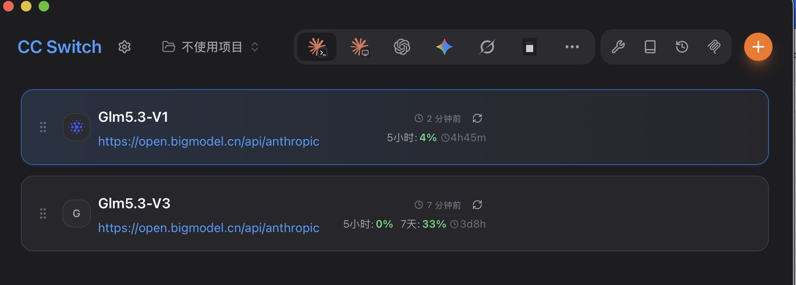

# 让 CC Switch 显示 GLM Coding Plan 额度卡片

> 适用对象：用 [CC Switch](https://github.com/farion1231/cc-switch) 管理 GLM（智谱）供应商，想让供应商卡片直接显示「5小时剩余 xx%」「每周剩余 xx%」与重置时间的用户。
> 不需要安装本仓库任何东西，不需要写代码——复制粘贴一段脚本即可。

## 工作原理

CC Switch 的「额度/用量脚本」（usage script）功能会在沙盒 JS 引擎中执行你粘贴的脚本：

- `request` —— 定义一次 HTTP 查询，由 CC Switch 代为发出；
- `extractor` —— 把接口返回解析成若干额度条目（名称/已用/剩余/重置时间）；
- `{{apiKey}}` —— 模板变量，执行前自动替换为**该供应商配置里已填写的 API Key**，因此脚本本身不含任何明文密钥，也不需要你往脚本里粘贴 token。

额度数据来自智谱官方监控接口 `GET https://open.bigmodel.cn/api/monitor/usage/quota/limit`——与 glm-quota-hud 状态栏监控用的是同一个接口、同一份语义。

## 前提条件

1. CC Switch 为较新版本（具备供应商「额度/用量脚本」自定义功能；在供应商编辑界面找不到相关配置即说明版本过旧，请先升级）。
2. 至少一个 GLM Coding Plan 账号，并且该供应商在 CC Switch 里填写的 API Key 就是此账号的令牌（额度接口与 API 调用使用同一凭据）。

## 配置步骤

不同版本 CC Switch 的界面措辞略有差异，寻找关键词：**额度 / 用量 / Usage / 用量脚本 / Usage Script**。

### 首选：内置 Token Plan 模板（零脚本，最稳）

1. 打开 CC Switch（建议 v4.0.20+），进入该 GLM 供应商的**编辑**界面。
2. 找到「额度 / 用量脚本」配置区，类型选 **Token Plan / 编码计划**，供应商选 **Zhipu（智谱）**（新版会按 base_url 自动识别）。
3. 直接启用保存——CC Switch 用**内置智谱查询**渲染卡片（5 小时 / 每周窗口 + 重置时间），无需粘贴任何脚本。
4. 多个 GLM 账号：每个供应商同样设置即可，各查各的 Key。

> 注意：Token Plan 类型下**粘贴自定义脚本是无效的**——内置查询不走用户脚本，卡片文案（含 emoji/符号）由程序内部 i18n 生成，不可定制。

### 进阶：Custom 自定义脚本（可定制文案，有三条已知限制）

想要自定义文案（emoji / ↻ 等符号、合并行）时：类型改选 **Custom**，语言 JavaScript，粘贴 [`usage_script.example.js`](usage_script.example.js) 全文（`{{apiKey}}` 变量自动引用各供应商自己的 Key，脚本零密钥）。实测已知限制（v4.0.20）：

| 限制 | 说明 | 缓解 |
|---|---|---|
| 多档折叠 | 返回 ≥2 条额度时，卡片默认只显示「N 个套餐」摘要，要点开才见全部（产品内置行为，无设置项） | 脚本返回**单条目**（周池并入行尾文字） |
| label 截断 | 卡片 label 列固定 72px，超长截断（如「5小时(积分)」→「5小时(..」） | planName 用短文案（`5h` / `5h·积分`） |
| 空池报错 | token 制账号 5h 窗口闲置耗尽后接口**隐藏该池**，脚本若滤净 MCP 池会返回空数组报错 | 脚本带 MCP 池兜底 |

## 额度条目怎么读

脚本对接口返回的每个额度池按以下规则归类：

| 接口字段 | 取值 | 含义 | 卡片呈现 |
|---|---|---|---|
| `type` | `TOKENS_LIMIT` | token 制套餐（5h 窗口型） | 5小时 |
| `type` | `CREDIT_LIMIT` | 积分制套餐（5h 窗口 + 周积分池） | 5小时(积分) / 每周(积分) |
| `type` | `TIME_LIMIT` | MCP 周池 | 内置模板不展示；本仓库脚本作兜底显示 |
| `unit` | `3` | 5 小时滚动窗口 | 「5小时」行 |
| `unit` | `6` | 每周窗口 | 「每周」行 |
| `percentage` | 0-100 | 已用百分比 | 剩余 = 100 − 已用 |
| `nextResetTime` | 毫秒时间戳 | 重置时刻 | 重置时间（内置版显示倒计时） |

两个已知接口行为，不是脚本 bug：

- **5h 窗口闲置过期后接口不再返回该池**（隐藏规则），此时积分制账号可能只剩「每周」一行；两个池都不返回时卡片会显示「未返回额度池」提示。
- 周池重置按自然周固定时刻，5h 窗口为滚动窗口，两者重置时间互不相关。

## 排错

| 症状 | 原因 | 处理 |
|---|---|---|
| 供应商编辑里找不到脚本配置 | CC Switch 版本过旧 | 升级 CC Switch |
| 卡片显示 HTTP 401 | Key 无效，或该 Key 不是 GLM Coding Plan 令牌 | 核对供应商的 API Key；可将脚本里 `Authorization` 改为 `"Bearer {{apiKey}}"` 再试 |
| 卡片显示「未返回额度池」 | 接口 `limits` 为空 | Key 正确但所有窗口均未激活（新号/闲置号常见），产生用量后会正常显示 |
| 卡片额度行一直空白 | 脚本未启用，或粘贴时截断 | 重新完整粘贴并确认开关已启用 |
| 额度被折叠成「N 个套餐」摘要 | 返回了 ≥2 条额度，卡片对多档强制折叠（产品行为，无设置项） | 脚本改为返回单条目（周池并入行尾文字） |
| custom 脚本粘贴后卡片显示「只有余额」等残缺形态 | 旧版本前端对脚本返回结构兼容性差（如裸对象） | 升级 CC Switch 至 v4.0.20+；脚本返回**数组**结构 |
| 请求被拒（域名/同源报错） | 使用了非 custom 类型模板，请求域名须与供应商 base_url 同源 | 脚本类型改回「自定义（custom）」 |
| 查询超时 | 引擎单次执行上限 5 秒 | 一般为网络问题，稍后重试 |

## 给 AI 助手的说明（可直接照做）

若你（AI 助手）正帮用户让 CC Switch 显示 GLM 额度卡片，按以下清单执行：

1. 确认用户已安装 CC Switch（建议 v4.0.20+）且其中配置了 GLM（智谱）供应商，其 API Key 为用户自己的 GLM Coding Plan 令牌。
2. **首选方案**：指导用户在该供应商编辑界面 → 「额度/用量脚本」→ 类型选 **Token Plan**（供应商选 Zhipu/智谱）→ 启用保存。零脚本，内置查询，最稳。
3. **仅当用户要求自定义文案（emoji/符号/合并行）**：类型改 **Custom** + 语言 JavaScript，粘贴本目录 `usage_script.example.js` 全文。**不要**修改其中的 URL、`{{apiKey}}` 变量与判别逻辑；不要把任何真实密钥写入脚本或输出到对话。注意上文三条已知限制。
4. 验证：供应商卡片出现额度行与重置时间；异常按上方排错表定位。
5. 多个 GLM 账号：对每个供应商重复步骤 2 或 3。

## 与 glm-quota-hud 状态栏的关系

CC Switch 卡片是**打开应用时的手动查询视图**；glm-quota-hud 把同样的额度搬进 Claude Code 状态栏**常驻监控**，并提供速率预测、90% 预警、窗口到期通知等（见[主 README](../README.md)）。两者使用同一接口，互不依赖，可单独或组合使用。
